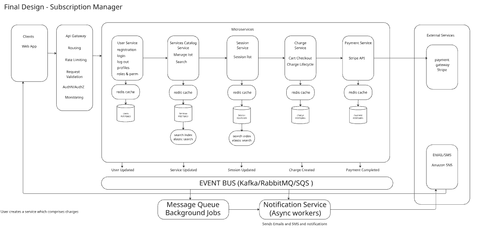

# Subscription Serverless Application



Use a separate service for each microservice, with step functions in a dedicated workflow/orchestration service eg workflows extending multiple services.

Amazon States Language (ASL) 

Workflows are called state machines, Your workflows will contain states that either take action or control the flow of your state machines.

Each service should own its:

- Lambda functions
- DynamoDB tables/cache
- IAM permissions
- Events and business logic
- Deployment lifecycle

Use:

- Step Functions for commands and ordered business workflows.
- EventBridge for events such as UserUpdated, PaymentCompleted, and ChargeCreated.
- SQS for background jobs and notification buffering.
- API Gateway only for client-facing endpoints.  


```
online-store/
  services/
    users/
      serverless.yml
      handlers/
    catalog/
      serverless.yml
      handlers/
    subscriptions/
      serverless.yml
      handlers/
    payments/
      serverless.yml
      handlers/
    notifications/
      serverless.yml
      handlers/
  workflows/
    checkout/
      serverless.yml
      handlers/
  serverless-compose.yml
```

## Commands

```
npm install
serverless deploy
curl https://xxxxxxx.execute-api.us-east-1.amazonaws.com/

- Local Dev
serverless dev

```

## Endpoint Tests 

```
curl --request POST \
  'https://1m65skl5z7.execute-api.us-east-1.amazonaws.com/dev/users/create' \
  --header 'Content-Type: application/json' \
  --data '{
    "id": "user-1",
    "name": "Jane Doe",
    "email": "jane@example.com",
    "password": "secret"
  }'
  
```