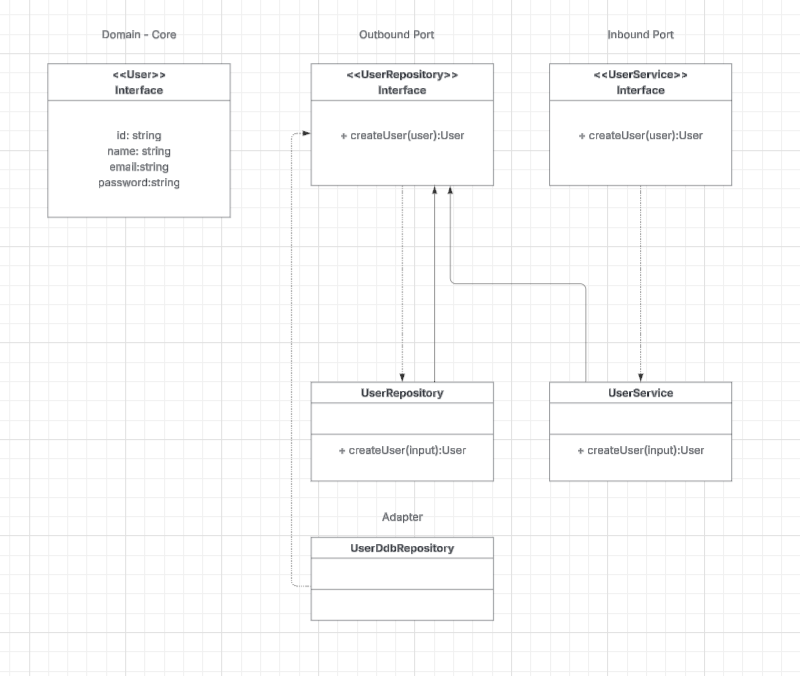

# User Service



 Hexagonal Ports and Adapters Pattern for maintainability  

- Fast Cold Starts
- Easy Mocking & Testing
- Separation of Concerns

## Endpoint Tests 

```
curl --request POST \
  'https://1m65skl5z7.execute-api.us-east-1.amazonaws.com/dev/domain/users/create' \
  --header 'Content-Type: application/json' \
  --data '{
    "id": "user-1",
    "name": "Jane Doe",
    "email": "jane@example.com",
    "password": "secret"
  }'
  
serverless users logs -f createUser

```

References:
https://miladezzat.medium.com/hexagonal-architecture-ports-and-adapters-pattern-5ad2421802ec